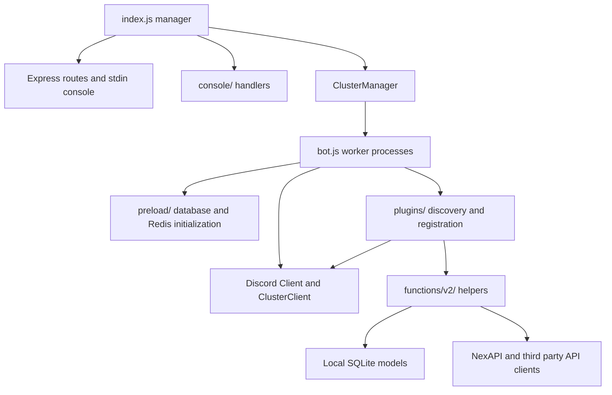

# Architecture

## Entry points and process boundaries

[`package.json`](../package.json) identifies `index.js` as `main` and defines `start` as `node index.js`. The code uses CommonJS. Its import mappings resolve `#config/*`, `#functions/*`, `#preload/*`, and `#console/*` to matching `.js` paths; `#bot` and `#index` resolve to the two root modules.

[`index.js`](../index.js), principally `main()`, owns the Express server, stdin console, file logging, update polling, and `ClusterManager`. [`bot.js`](../bot.js) is the worker target. Each worker owns a Discord `Client`, `ClusterClient`, command and cooldown collections, database preload modules, and Discord event listeners. Manager options specify process mode, automatic shard count and two shards per cluster; `devMode` instead selects four shards and one shard per cluster.

This diagram shows source relationships, not verified running services.

## Manager startup sequence

In `index.js`, top-level code loads dotenv and core configuration, creates global `DateFormatter`, registers exception/rejection handlers, and parses CLI flags. It imports Discord/configuration dependencies, attempts `process.chdir(__dirname)`, creates missing `logs`, `plugins`, and `preload` directories, opens a readline interface, and optionally redirects stdout/stderr into a timestamped log. It defines Express GET routes before calling `main()`.

`main()` performs the following operations in order:

1. Awaits `getUpdateVersion()` and starts `app.listen(port)`.
2. Publishes manager exports (`server`, `helpMenu`, `readline`, `spawn`, `exitHandler`, `chatLog`, `latestVersion`, and reload wrappers).
3. Unless manager safe mode is enabled, requires `.js` files one directory below `console/`, awaits exported `ready`, calls `execute()` when callable, and collects `help()` results.
4. Writes `PRISM_VERBOSE`, constructs the cluster manager, installs reload handlers, and extends it with `ReClusterManager` and `AutoResharderManager`.
5. Awaits `manager.spawn({ timeout: -1 })`. The completion callback invokes manager `asyncFunctions()`, prints startup/version messages, and requests user identity through `broadcastEval`.
6. Requests `deployCommands` from cluster zero and throws if its reply reports failure.

Manager `asyncFunctions()` invokes console `post(verbose)` hooks without awaiting their results, launches the asynchronous stdin parser, and conditionally launches hourly update polling. The exported numeric `latestVersion` is a startup value; later reassignment of the local variable does not update that export.

## Worker startup sequence

The async startup function in `bot.js`:

1. Recursively discovers `preload/` JavaScript files through `getJSFiles()`, requires each, and awaits its `execute()` export when present. Database synchronization and Redis connection precede Discord client creation.
2. Constructs the Discord client using `getInfo().SHARD_LIST` and `TOTAL_SHARDS`, configured intents/partials/presence, then attaches `ClusterClient` and `AutoResharderClusterClient` with a 60-second data interval.
3. Fetches the remote framework version and publishes `helpMenu`, `spawn`, `chatLog`, `client`, and `latestVersion` exports.
4. Discovers `plugins/`, requires modules, awaits `ready`, and serializes command data. Creates `client.cooldowns` and `client.commands`, and installs cluster-message handlers.
5. Reuses cached modules in a second pass: registers command modules by name, or calls non-command `execute()` hooks, or collects help (an `else if` chain).
6. Installs the one-shot `ClientReady` callback, delays one second, and calls `client.login(token)`.

On `ClientReady`, the worker starts `asyncFunctions()` without awaiting it, then calls `cluster.triggerReady()`. Worker `asyncFunctions()` traverses the original plugin list and invokes `post(verbose)` without awaiting it. Thus cluster readiness does not establish completion of post hooks. A helper's existence does not establish that a plugin calls it.

## Event and helper relationships

[`plugins/Essential/Handlers/slashHandler.js`](../plugins/Essential/Handlers/slashHandler.js) installs interaction dispatch from its non-command `execute()` hook. [`guildHandler.js`](../plugins/Essential/Handlers/guildHandler.js) installs guild join/leave handling, consults the local server blacklist, sends a welcome container, and optionally attempts invite-channel reporting.

[`plugins/Neru/handlers/`](../plugins/Neru/handlers/) installs message create/update/delete, member join/leave, and audit-log listeners. `messageHandler.execute()` calls `moderateMessage`; edited-message handling fetches partial messages, moderates, and logs edits. Deleted-message handling suppresses IDs in the AutoMod deletion set. `joinLeaveHandler.channelMessage()` expands configured message placeholders. Audit-log handling covers member bans, unbans, and kicks and ignores actions attributed to this bot.

Current commands import helpers in [`functions/v2/`](../functions/v2/). These include Components V2 containers/menus, local analytics and moderation, NexAPI-backed currency, notifications, and API clients. `createContainer`/`createAdvancedContainer` in [`discord/container.js`](../functions/v2/discord/container.js) can fetch advertisements; `replyContainer` in [`discord/replyContainer.js`](../functions/v2/discord/replyContainer.js) can subsequently check remote notifications. Even presentation helpers can therefore depend on NexAPI.

## Older and diagnostic code

Neither loader recursively scans `functions/`, `legacy/`, or `test/`. Helpers there require an explicit import to become active. Current plugin imports inspected point to v2 helpers, while, for example, [`functions/v1/api/fetch.js`](../functions/v1/api/fetch.js) imports `#app-config`, which is absent from the package import map. That older signature is not the v2 API contract. `scripts/migrate.cjs` is a separate import-rewriting utility, not invoked by either entry point.

Conversely, `plugins/Testing/Shards.js` resides in a loader root and declares `shardtest`; its diagnostic name does not disable it. The loader has no per-deployment selection by `MikuBot`, `Teto`, `Neru`, `Shared`, or `NexAPI` folder names. Actual production file selections and running processes cannot be established from these files.
